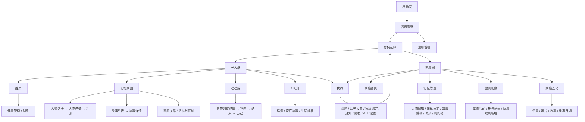

# 产品架构与页面清单

> v0.1历史基线：当前功能、工具版本与验收状态请查看 [v0.2实现与验收](06-v0.2-实现与验收.md)。


## 目标用户与场景

| 角色 | 主要场景 | 设计响应 |
| --- | --- | --- |
| 老人（演示用户张淑芬） | 每天打开看看家人、做一个活动、与忆伴说话 | 首页三个核心动作，大字、短句、可读标签 |
| 家属 | 补充家庭记忆、了解参与记录、留下问候 | 家庭概览、管理入口、事实记录 |
| 家庭共同空间 | 照片、亲属关系、声音与故事关联 | 同一家庭数据源，以人物和时间为索引 |

演示家庭：王建国（老伴）、张小明（儿子）、李小红（孙女）。姓名、关系、任务与记录均为虚构。家属模式中“妈妈”指张淑芬。

## 页面结构图



## 导航规则

- 老人：**首页 / 记忆家园 / 动动脑 / AI陪伴 / 我的**。
- 家属：**家庭首页 / 记忆管理 / 健康观察 / 家庭互动 / 我的**。
- 底栏只出现在一级页面，详情页不显示；详情顶部有带文字的返回按钮。
- 一级切换使用 `uni.reLaunch`；详情 `uni.navigateTo`；若页面栈不足则返回当前模式首页。
- 角色选择与“我的”可以切换体验；演示存储保存模式和字号，退出清除模式。真实登录和服务端家庭权限是后续范围。
- 路由携带实体 ID 与训练类型，不传递完整敏感对象。无效或缺失实体后续展示温和空态。

## 完整页面表（路由清单为可执行来源）

| 组 | 页面路径（省略 pages/） | 用途 | 本轮状态 |
| --- | --- | --- | --- |
| 入口 | welcome/index | 启动、品牌、进入演示 | 可交互 |
| 入口 | auth/login | 演示登录、隐私说明入口 | 可交互，无认证 |
| 入口 | auth/register | 注册流程说明 | 骨架 |
| 入口 | auth/role | 角色选择 | 可交互 |
| 老人一级 | elder/home | 问候、任务、记忆、家人消息 | 首页预览 |
| 老人一级 | memory/index | 家人、故事、关系、相册入口 | 导航骨架 + Mock |
| 共享记忆 | memory/people | 人物列表 | 导航骨架 |
| 共享记忆 | memory/person | 人物详情，参数 id | 骨架 |
| 共享记忆 | memory/stories | 故事列表 | 导航骨架 |
| 共享记忆 | memory/story | 故事详情，参数 id | 骨架 |
| 共享记忆 | memory/relations | 家庭关系可读列表 | 骨架 |
| 共享记忆 | memory/timeline | 记忆时间轴 | 骨架 |
| 共享记忆 | memory/album | 家庭相册，后续 previewImage | 骨架 |
| 老人一级 | training/index | 五种认知活动分类 | 导航骨架 |
| 训练 | training/detail | 按 type 复用，memory/attention/language/executive/spatial | 骨架 |
| 训练 | training/play | 模拟题、退出确认 | 骨架 |
| 训练 | training/result | 本次正确数、用时、鼓励语 | 骨架，不显示医疗结论 |
| 训练 | training/history | 活动历史 | 骨架 |
| 老人一级 | companion/index | 模拟AI陪伴、话题与语音状态 | 骨架，无实际对话 |
| 健康 | health/index | 今日任务、散步和交流记录 | 骨架 |
| 家属一级 | family/home | 老人近况、活动事实、待办、添加入口 | 首页预览 |
| 家属一级 | family/memory | 记忆管理入口 | 导航骨架 |
| 家属管理 | family/person-edit | 添加/编辑人物，id 可选 | 骨架，无保存 |
| 家属管理 | family/story-edit | 添加/编辑故事，id 可选 | 骨架，无保存 |
| 家属管理 | family/media-add | 照片、语音、视频选择 | 骨架，无上传 |
| 家属一级 | family/observation | 周活动与实际记录 | 导航骨架 |
| 家属管理 | family/observation-add | 家属观察记录，非诊断 | 骨架 |
| 家属一级 | family/interaction | 留言、共享照片、日期提醒 | 导航骨架 |
| 家庭互动 | family/message-add | 文字/语音留言 | 骨架 |
| 家庭互动 | family/dates | 生日和纪念日 | 骨架 |
| 共享一级 | account/index | 各模式账号入口、切换 | 可交互 |
| 共享设置 | account/profile | 个人资料 | 骨架 |
| 共享设置 | account/accessibility | 字号、语音偏好 | 字号可用；语音开关仅存偏好 |
| 共享设置 | account/binding | 家庭成员绑定与邀请 | 骨架 |
| 共享设置 | account/notifications | 通知偏好 | 骨架 |
| 共享设置 | account/privacy | 演示说明、权限与授权 | 可阅读说明，授权业务待开发 |
| 共享设置 | account/settings | 应用信息、退出演示 | 可交互 |
| 共享 | messages/index | 家庭消息中心 | 骨架 |

## 代码分层

```text
pages → layouts + components → stores → api/repositories
                                      ├─ Mock adapter → mock（当前）
                                      └─ HTTP adapter → request → FastAPI（未来）
config/routes.ts → scripts/generate-pages.mjs → pages.json
types → 页面、store、repository 共用的数据契约
styles/tokens.scss → 全局视觉语义
```

## 数据契约与扩展

统一 ID、家庭 ID、关系、时间戳和媒体元数据；后续扩展 `Person / Story / MediaAsset / Task / ActivityRecord / Observation / Conversation / FamilyMembership / Consent`。Mock 与 HTTP adapter 返回相同类型。

真实账户引入后，角色与家庭成员授权必须由服务端验证；不能依靠本地 mode 判断可访问家庭。老人本人可撤销分享，家属只获得明确授权的范围。详情和管理页面在后续接权限守卫。
