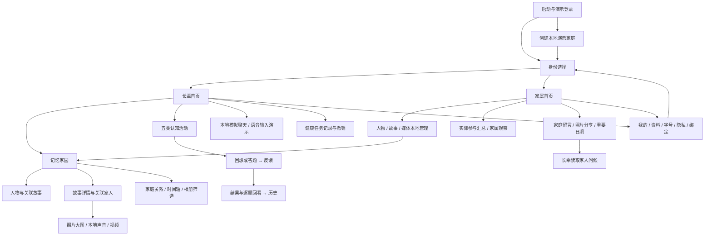

# 忆伴 v0.2 · 实现与验收

交付日期：2026-11-16。当前是使用统一 Mock 与本地存储的可交互产品原型。v0.1 的“页面骨架”已被业务模块替换；本文件和根目录 README 是当前状态说明。

## 按阶段交付

| 阶段 | 实现与主要修改文件 | 实际检查 |
| --- | --- | --- |
| 基础工程、导航复核 | `config/routes.*`、`pages.json`、`layouts/AppLayout.vue`、`utils/navigation.ts` | 38路由实体、两种五项底栏、角色入口、详情返回；限制页面栈累积 |
| 统一数据层 | `types/index.ts`、`mock/database.ts`、`mock/catalog.ts`、`api/repositories.ts`、`stores/family.ts` | 本地事务保存、跨模式读取、刷新保留、空间不足不产生假成功 |
| 记忆模块 | `modules/memory/*`、`MediaPlayer`、`FormField`、`EmptyState`、`utils/media.ts` | 8组人物/故事/照片/关系/时间轴/音频/共享流程通过 |
| 认知活动 | `modules/training/TrainingScreen.vue`、Mock题库、训练记录事务 | 5类共15题、每类完整作答、错题反馈、结果历史、中途退出；6组通过 |
| 陪伴与健康 | `modules/companion/*`、`modules/health/*`、`api/ai.ts`、`mock/companion.ts` | 文字及语音状态、离线回复、健康记录撤销、观察与分享限制；7组通过 |
| 家庭互动与设置 | `modules/family/*`、`modules/account/*`、`ToggleRow`、日期工具 | 留言及照片、日期CRUD、资料、邀请与绑定、编辑授权、通知偏好；7组通过 |
| 完整性与错误恢复 | 首页空数据处理、关联清理、恢复示例、本地注册与表单校验 | 5组删除、空状态、重置、注册、存储故障检查通过 |
| Android适配与运行 | 同版DCloud依赖、`scripts/run-android.ps1`、官方运行插件 | 官方基座安装、同步及启动；实际REDMI手机交互、输入保存与重启保留通过 |

所有页使用统一布局、按钮、卡片、字号变量和反馈组件。新增表单统一校验并保持失败时的输入。没有通过批量空白页面冒充模块。

## 当前可体验流程

## 实际验证结果

### 工程

- `npm run check`：38路由检查和TypeScript通过。
- `npm run build:h5`：通过，编译器5.26。
- `npm run build:app`：通过，编译器5.26。
- HBuilderX官方CLI Android调试编译、程序同步、标准基座安装与启动：通过。
- `scripts/run-android.ps1` 已实际用于运行本机项目。

最终依赖为 `3.0.0-5020620260917001`，DCloud编译包保持同版，匹配本机HBuilderX与手机SDK 5.26。开发中曾发现5.34编译资源与5.26基座的冷启动提示，已通过版本对齐修复；没有通过隐藏或忽略版本检查交付。

### 浏览器业务与布局

- 33组业务/完整性检查：记忆8、训练6、陪伴健康7、家庭与设置7、完整性5；在最终5.26编译器下重新验证通过。
- 真实文件选择：导入本地PNG、刷新后显示；选择本地WebM、保存后刷新并实际播放。视频播放时长约1.1秒，非仅显示标题或假按钮。测试文件是项目生成的素材。
- 38页 × 3种屏宽 = **114项**页面检查通过：390标准字、360/412特大字；核验实际内容、标题、字号、横向溢出以及不存在旧占位提示。
- 模拟AI在浏览器网络离线时仍可回复；未依赖外部大模型或后端。
- 单独注入本地存储写入失败，确认提示错误且不会保存人物或显示假成功。

### Android真机

设备：**REDMI K80 Ultra / Android 16**，物理分辨率1280×2772，Android System WebView Chrome 143。使用官方HBuilder调试基座，不是浏览器模拟手机。

已实际验证：

1. 老人端五项和家属端五项底栏切换。
2. 一次完整注意力活动、逐题反馈、正确数结果和活动历史。
3. 模拟聊天、语音输入状态及家庭故事回复。
4. 打包在App中的WAV示例语音播放与暂停。
5. 个人资料入口和APP内返回；共享活动状态在模式切换后保留。
6. 用户在手机原生输入框填写“真机测试家人 / 亲友”并保存成功，随后由助手在人物列表独立确认。
7. 强制结束并重新启动App、重新同步匹配版本资源后，新增人物和原有活动记录仍保留。
8. 原生照片大图实际打开，截图确认显示示例家庭合影。
9. 首屏、状态栏和底部导航的实际画面检查；版本对齐后冷启动不再显示SDK不匹配提示。

真机自动化通过USB调试连接App WebView执行实际UI操作。原生输入由用户手动协助验证；未把桌面工具修改DOM的结果视为手机真实输入成功。

**未通过自动化覆盖的原生项：** 手机限制ADB系统按键注入，模拟系统返回得到 `INJECT_EVENTS` 权限错误；因此系统手势返回仍列为人工专项验收，APP内返回已验证。未为测试更改该权限。Android系统相册/视频选择、权限拒绝、系统级通知、TalkBack和多机型兼容未在本轮全部覆盖；本地文件选择流程已在浏览器真实执行。

## 测试证据与复现

场景脚本：`mobile/scripts/qa/`；浏览器日志：`output/playwright/*-v02.txt`；Android日志与截图：`output/android/`。输出目录不打进源码版本控制，关键预览复制到 `docs/previews/v0.2/`。

可运行的场景脚本通过 `playwright-cli run-code --filename ...` 执行，不是 `@playwright/test` 测试套件。浏览器场景应在独立测试会话中运行：记忆场景会重置该会话的演示资料；完整性场景会删除该测试会话的故事并恢复示例。不要对正在使用的个人会话运行数据清理测试。

Android脚本要求先连接本项目的调试WebView；持久化脚本还要求已经手工添加上述测试人物。手机中的原有参与记录和测试人物均被保留，未使用恢复示例来完成真机验收。

## 明确的产品边界

- 一个设备中体验两种模式，尚无跨设备同步、真实认证或服务端授权。
- 语音识别为模拟输入；声音为合成示例。没有真实录音、ASR、大模型或逐条实时TTS。
- 可导入照片/视频并添加示例语音；真实个人音频文件导入尚未提供。
- 日期与提醒偏好为本地功能，未实现后台推送和系统闹钟。
- 当前手机上通过官方基座运行。独立发行APK仍需作者配置DCloud AppID、包名和签名；本轮未发布独立APK。
- 训练分数仅代表本次题目作答；观察只展示活动事实与家属文字，不计算医疗风险或疾病诊断。
- 本轮没有引入或启用新的后端技术和外部业务接口，后续后端契约与选型另行确定。
